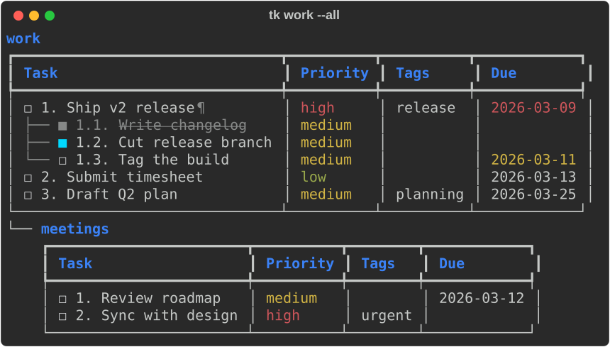
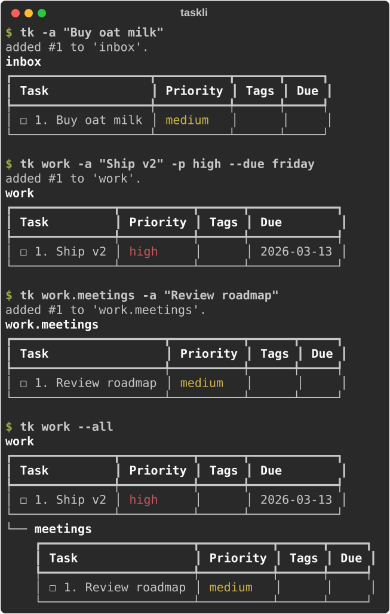
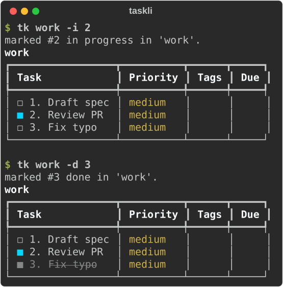
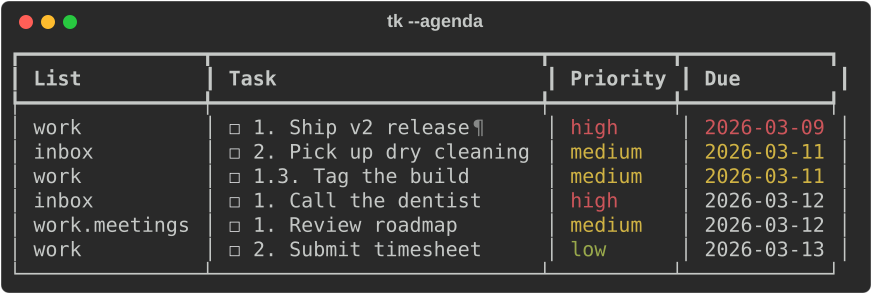
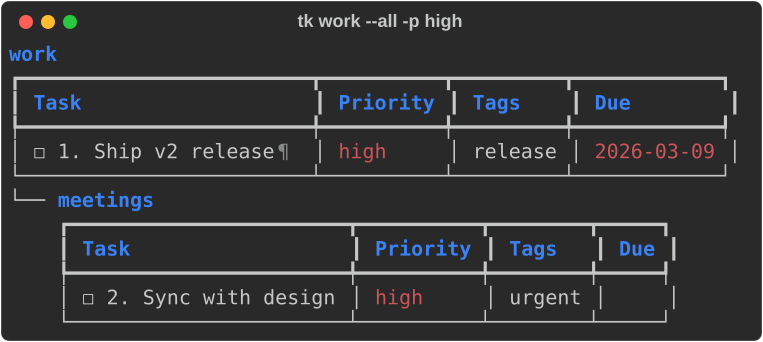
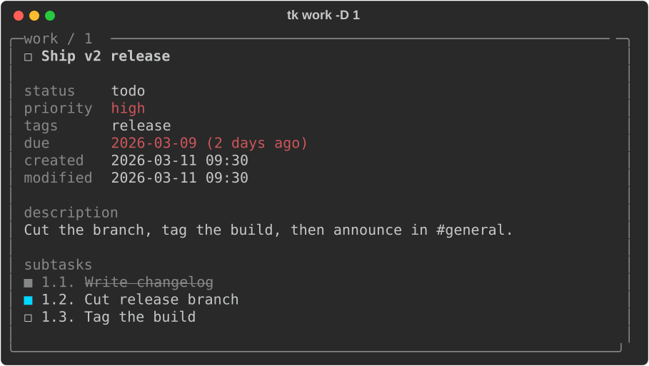
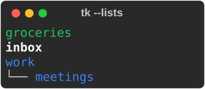

<div align="center">

# taskli

**Nested task lists for your terminal.**
One command, one JSON file per list, and output that's actually nice to read.


[](https://github.com/calvinmcelvain/taskli/actions/workflows/ci.yml)


[Install](#install) · [Quickstart](#quickstart) · [Tour](#tour) · [Cheat sheet](#cheat-sheet) · [Reference](https://github.com/calvinmcelvain/taskli/blob/main/docs/reference.md)



</div>

## Install

```bash
uv tool install git+https://github.com/calvinmcelvain/taskli.git
```

That puts `tk` (and its alias `taskli`) on your `PATH`.

> [!NOTE]
> taskli isn't on PyPI yet, so install straight from GitHub. It needs
> Python 3.11+. If `tk` isn't found afterwards, run `uv tool update-shell` once.

<details>
<summary>Using pipx, or installing from source</summary>

```bash
pipx install git+https://github.com/calvinmcelvain/taskli.git
```

To hack on it, see [CONTRIBUTING](https://github.com/calvinmcelvain/taskli/blob/main/CONTRIBUTING.md).

</details>

## Quickstart

```bash
tk -a "Buy oat milk"                                  # goes to your inbox
tk work -a "Ship v2" -p high --due friday             # any list, created on demand
tk work.meetings -a "Review roadmap"                  # a sublist of work
tk work --all                                         # see work and everything under it
```



> [!TIP]
> `tk` on its own shows your inbox. Every action is a flag, so a list can be
> named anything and `tk work` never gets confused with a command.

## The mental model

```text
work                          a list
├── 1  Ship v2                an item
│   └── 1.2  Tag the build    a subtask (any depth: 1.2.1, ...)
└── work.meetings             a sublist (up to 2 levels deep)
    └── 1  Review roadmap
```

Lists are named; items are numbered by position. That's the whole idea.

## Tour

### Check things off

Mark items done (`-d`), in progress (`-i`), or reset them (`-u`). Pass several
ids at once.

```bash
tk work -i 2
tk work -d 3
```



### Plan your day

Set a due date with `--due`; overdue items turn red and today's turn yellow.
`tk --agenda` pulls everything due, from every list, into one timeline.

```bash
tk work -a "Submit timesheet" --due friday
tk --agenda
```



`--due` takes `today`, `tomorrow`, `3 days`, `2 weeks`, a weekday name, or
`MM-DD-YYYY`. More in [Working with tasks](https://github.com/calvinmcelvain/taskli/blob/main/docs/tasks.md#due-dates).

### Find what matters

The default view is also a filter. Combine `--tag`, `-p`, `--today`,
`--undated`, and `--all`.

```bash
tk work --all -p high        # high priority, in work and every sublist
tk --today --all             # everything due today, across every list
```



### Break work down

Nest subtasks with `--under`. Ids become dotted paths (`1.2`) that every
command understands.

```bash
tk work -a "Cut release branch" --under 1
tk work -D 1                 # full detail: description, timestamps, subtasks
```



### Organize your lists

```bash
tk groceries --new --color green   # color-code a list
tk work -mv later 2 3              # move items between lists
tk work --rename job               # renames sublists too
tk --lists
```



## Cheat sheet

| I want to... | Type this |
|---|---|
| add a task | `tk work -a "Ship v2" -p high --tag release` |
| see a list | `tk work` |
| see a list and its sublists | `tk work --all` |
| finish / start / reopen | `tk work -d 1` · `tk work -i 1` · `tk work -u 1` |
| change a task | `tk work -e 1 -t "Ship v2.1" --due tomorrow` |
| add a subtask | `tk work -a "Tag build" --under 1` |
| see everything due | `tk --agenda` |
| clear out finished work | `tk work --prune` |
| delete a task | `tk work -rm 1` |
| copy or move to another list | `tk work --copy later 1` · `tk work -mv later 1` |
| change a setting | `tk --config default_priority high` |

Every flag and rule lives in the [full reference](https://github.com/calvinmcelvain/taskli/blob/main/docs/reference.md).

## Good to know

> [!WARNING]
> Ids are **positions**, not permanent. `-rm` and `--prune` renumber what's
> left, so don't reuse an id across commands that delete.

> [!WARNING]
> `-e --tag` **replaces** an item's tags. Use `--add-tag` to append.

> [!IMPORTANT]
> One action per call. If you mix flags from different groups (for example
> `--new` and `-a`), taskli runs one and warns about the others instead of
> guessing. `-d`, `-i`, `-u`, and `-rm` can combine freely.

## More

- [Working with tasks](https://github.com/calvinmcelvain/taskli/blob/main/docs/tasks.md): priorities, tags, due dates, descriptions, subtasks
- [Lists and sublists](https://github.com/calvinmcelvain/taskli/blob/main/docs/lists.md): nesting, colors, moving, cascading delete and rename
- [Configuration](https://github.com/calvinmcelvain/taskli/blob/main/docs/config.md): every setting
- [Tab completion](https://github.com/calvinmcelvain/taskli/blob/main/docs/completion.md): bash, zsh, PowerShell
- [Contributing](https://github.com/calvinmcelvain/taskli/blob/main/CONTRIBUTING.md)

Your data lives in `~/.taskli` (override with `TASKLI_PATH`). Run `tk --path` to see it.

Released under the [MIT License](https://github.com/calvinmcelvain/taskli/blob/main/LICENSE).
