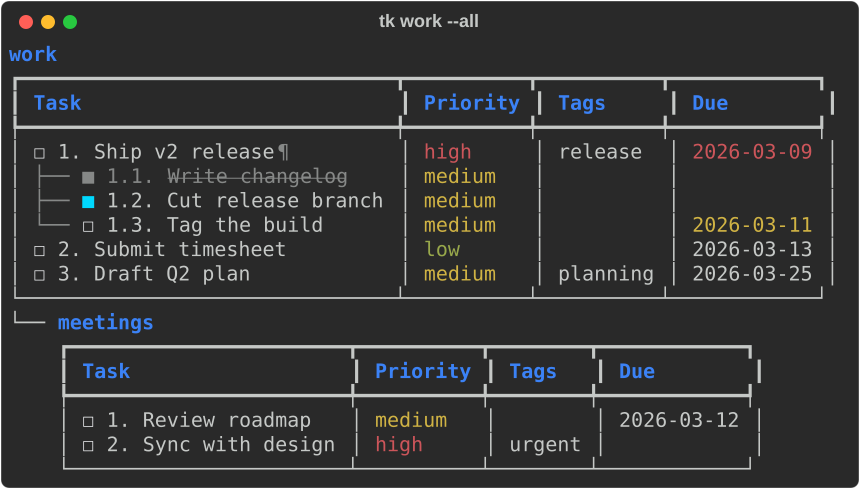
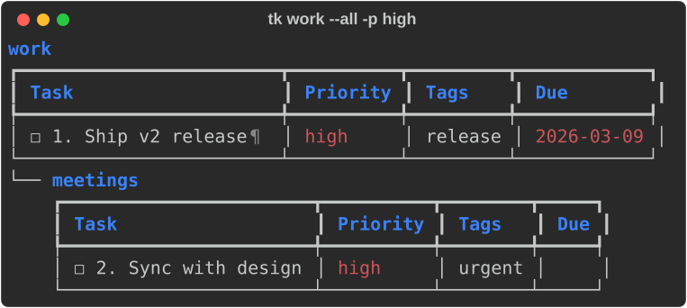

# Lists and sublists

Each list is one JSON file in `$TASKLI_PATH` (default `~/.taskli`), so your
data is readable, greppable, and easy to back up. `tk --path` prints the
directory in use.

## Creating lists

Lists are created the first time you add to them:

```bash
tk groceries -a "Oat milk"       # creates 'groceries'
tk groceries --new --color teal  # or create one explicitly, with a color
```

`inbox` (the [`default_list`](config.md)) exists from the first run.

## Sublists

Join names with a `.` to nest a list under another:

```bash
tk work.meetings -a "Review roadmap"
```


- Nesting is capped at **2 sublist levels**, i.e. three name segments
  (`work.meetings.standup`). A fourth is an error.
- **Missing parents are created automatically.** `tk work.meetings -a ...`
  makes an empty `work` first.
- A list view shows only that list's own items. Add `--all` to include every
  descendant as a tree:



- Section headers show the **full dotted name** (`work.meetings`), so you
  can act on it directly: `tk work.meetings -d 1`.
- Filters apply to every section: `tk work --all -p high` filters `work`
  *and* its sublists. A sublist with no matches still renders, just empty.



Without `LIST`, `tk --all` shows every list.

## Cascading actions

`--delete` and `--rename` on a parent act on every descendant:

```console
$ tk work --delete
delete list 'work' and its 1 sublist(s) (work.meetings) and all their items? [y/N]: y
deleted list 'work' and 1 sublist(s).

$ tk work --rename job
renamed 'work' to 'job' and 1 sublist(s).
```

If the renamed list is your `default_list`, the config follows the new name.

## Colors

Pick one of 16 colors with `--color`, either when creating a list or on its
own to recolor one:

`white` `red` `coral` `orange` `yellow` `lime` `green` `teal` `cyan` `sky`
`blue` `indigo` `violet` `purple` `magenta` `pink`

```bash
tk groceries --new --color teal
tk work --color coral
```

A new sublist inherits the nearest ancestor's color unless you pass
`--color`. Turn that off with `tk --config inherit_sublist_color false`.

## Moving and copying items

```bash
tk work -mv later 2 3     # move items 2 and 3 into 'later'
tk work --copy later      # copy every item (omit ids for the whole list)
```

The target list (and any missing parents) is created on demand. Copied and
moved items keep their original creation time, so under the default sort
they land by that time rather than always last.

## Pruning

`tk work --prune` removes done items. `--all` extends it to sublists, or to
every list when you give no `LIST`. Set `tk --config auto_prune true` to
prune whenever you view a list.
