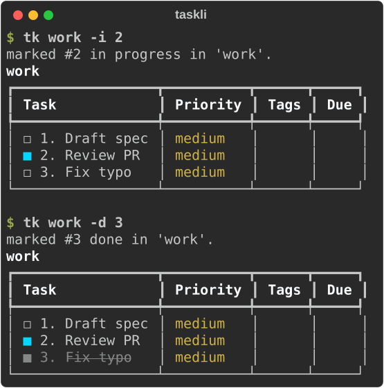
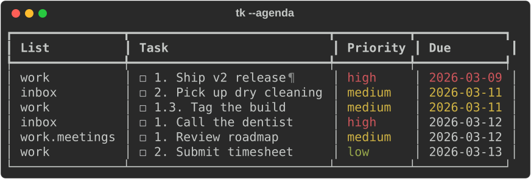
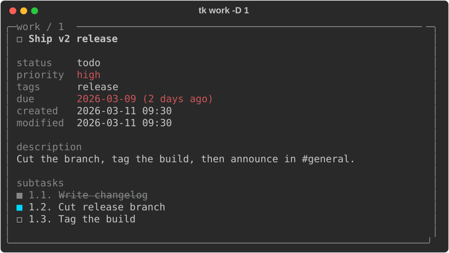

# Working with tasks

## Status

Every item is in one of three states, shown by the marker before its id:



| Marker | State | Set with |
|---|---|---|
| `☐` | not started | `-u` |
| `■` (cyan) | in progress | `-i` |
| `■` (dim, struck through) | done | `-d` |

`-u` resets an item from either done or in progress. Marking a parent done
does **not** touch its subtasks.

## Priorities

`low`, `medium` (default), or `high`, set with `-p`:

```bash
tk work -a "Ship v2" -p high
tk work -e 1 -p low
tk work -p high          # filter: show only high priority
```

Change the default with [`default_priority`](config.md).

## Tags

Items carry any number of free-form tags. `--tag` is **dual-purpose**:

```bash
tk work -a "Ship v2" --tag urgent --tag release   # set on add
tk work -e 1 --tag blocked                         # replace all tags
tk work -e 1 --add-tag review                      # append, keep the rest
tk work --tag urgent                               # filter the view
```

Filters match one tag, exactly, case-insensitively.

> [!IMPORTANT]
> `-e --tag` **replaces** the entire tag list. Use `--add-tag` to append.

## Due dates

`--due` sets a due date on `-a`/`-e` and filters on the default view.

| Value | Meaning |
|---|---|
| `today`, `tomorrow`, `next-week` | Relative to today. |
| `N days`, `N weeks` | e.g. `"3 days"`, `"2 weeks"`. |
| `monday` ... `sunday` (or `mon` ... `sun`) | The closest upcoming one; naming today's weekday means next week. |
| `MM-DD-YYYY` | An explicit date. |

```bash
tk work -a "Submit timesheet" --due friday
tk work -e 3 --due "3 days"
```

The `Due` column turns **red** when an item is overdue and **yellow** when
it's due today (done items are never highlighted).

### Filtering by due date

On the default view `--due` is repeatable and the values **OR** together:

```bash
tk work --due overdue                # only overdue items
tk work --due today --due tomorrow   # due today or tomorrow
tk work --today                      # shorthand for --due today
tk work --undated                    # not-done items with no due date
tk work --undated --due today        # undated, or due today
tk --today --all                     # across every list
```

`--due overdue`, `--due none`, `--today`, and `--undated` are filter-only;
`-a`/`-e` reject them. There is no way to clear a due date once set.

### Across every list

[`tk --agenda`](reference.md#--agenda) gathers everything due from all lists
into one chronological table:



When anything is overdue or due today, a one-line reminder also prints
above other commands. Turn it off with `tk --config show_reminders false`.

## Descriptions

`--desc` attaches longer notes to an item; `--desc ""` clears it. A dim `¶`
after the task text marks items that have one, and `-D` shows it in full:

```bash
tk work -a "Ship v2 release" --desc "Cut the branch, then tag the build."
tk work -D 1
```



## Subtasks

Any item can have **subtasks**, nested to any depth. Add one with `--under`:

```bash
tk work -a "Ship v2 release"
tk work -a "Cut release branch" --under 1     # becomes 1.1
tk work -a "Tag the build" --under 1          # becomes 1.2
```

Ids are dotted paths (`1`, `1.2`, `1.2.1`) and every id-taking flag accepts
them (`tk work -d 1.2`). Move an existing item with `-e`:

```bash
tk work -e 3 --under 1       # nest item 3 under item 1
tk work -e 1.2 --under ""    # promote back to the top level
```

- Removing a parent removes its whole subtree.
- `--prune` only removes a done item when **everything under it** is done.
- `-mv`/`--copy` carry the subtree along.

## Sorting

Items sort by creation time by default. `tk --config default_sort <key>`
changes that to `priority`, `tags`, or `due_date` (undated last) and
re-sorts every list. Editing an item does not re-sort until the next add.
